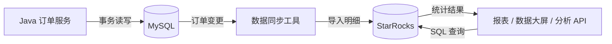
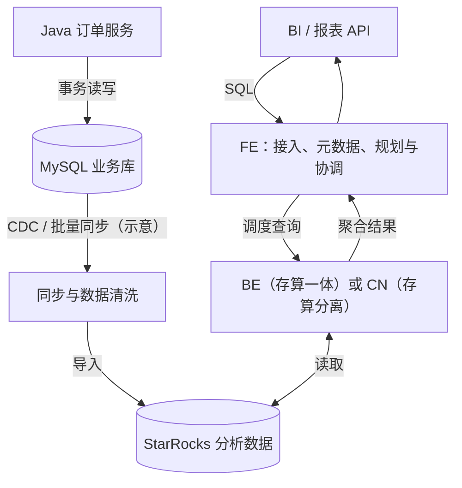

# StarRocks 是什么？为什么需要 OLAP 数据库？

> StarRocks What 系列 01/15 · 中文技术审阅稿 · 2026-11-10  
> 目标读者：有十年 Java/MySQL 经验的工程师。  
> 核心问题：为什么“查询订单”与“分析订单”会催生不同的数据库设计？

## 一、问题引入：从物流订单日报开始

一个物流订单系统用 MySQL 保存订单。订单服务关心创建订单、修改状态、按主键查询，运营报表则要统计“昨天每个网点有多少有效订单”，并按日期、网点、地区和状态灵活钻取。

```sql
SELECT order_day, site_id, COUNT(*) AS order_count
FROM orders
WHERE order_day >= '2026-11-06'
  AND order_day < '2026-11-07'
GROUP BY order_day, site_id
ORDER BY order_count DESC;
```

这条 SQL 在 MySQL 中完全合法。**问题不在于 MySQL 不能聚合，而在于数据量、扫描范围、查询并发、维度组合和事务写入压力增长后，分析负载与事务负载的优化目标可能冲突。**

订单服务希望迅速定位一行并原子更新；报表希望扫描大量行、只读取少数列、执行聚合并合并结果。更重要的是：必须先定义“有效订单”——创建事件数、当前有效订单数还是去重订单数？若订单被撤销、消息被重复投递，`COUNT(*)` 可能统计错误。数据库再快也不能替代业务口径。

## 二、概念定位：OLTP 与 OLAP 是负载差异

**OLTP（Online Transaction Processing，联机事务处理）**侧重处理日常业务操作，例如创建订单、支付和更新配送状态。**OLAP（Online Analytical Processing，联机分析处理）**侧重从大量数据中计算统计结果，例如分析各地区的订单趋势和收入构成。

放到同一个物流系统中，两类负载的区别更直观：

| 业务问题 | 数据库主要做什么 | 典型负载 |
| --- | --- | --- |
| 查询订单 `10001` 的配送状态 | 按订单号定位少量记录 | OLTP |
| 完成支付并更新订单状态 | 在事务中修改相关记录 | OLTP |
| 统计过去一年各地区每天的订单量 | 扫描大量记录，按日期和地区分组计算 | OLAP |
| 关联订单、网点和客户表，分析各类客户的收入贡献 | 多表关联、多维过滤与聚合 | OLAP |

它们都可以用 SQL 表达，但对存储和计算的要求不同：

| 维度 | 典型 OLTP | 典型 OLAP |
| --- | --- | --- |
| 访问方式 | 主键点查、短事务、少量行更新 | 大范围扫描、多维过滤、JOIN、GROUP BY |
| 优化目标 | 单事务延迟、写入并发、事务正确性 | 扫描吞吐、并行计算、聚合延迟 |
| 常见组织 | 行式布局、事务索引 | 列式布局、压缩、数据跳过 |
| 主要风险 | 锁竞争、热点、日志与随机 I/O | 扫描字节、内存、CPU、网络交换与倾斜 |
| 正确性关注 | 提交、约束、事务隔离 | 数据新鲜度、口径、去重、快照可见性 |

这些是典型倾向而非绝对规则：MySQL 可以承担适量分析，OLAP 数据库也可以支持更新。架构选型必须以实际负载为依据。

## 三、StarRocks 是什么？

### 3.1 先把它理解为一套专门做分析的数据库

**StarRocks 是一套可以独立部署、通过 SQL 查询数据的开源分析数据库。** 和使用 MySQL 一样，你可以在其中创建数据库和表、导入数据，再查询结果。它主要服务于报表、数据大屏和业务分析接口，重点优化大量数据的过滤、关联与聚合。

**[F·官方事实]** StarRocks 兼容 MySQL 协议，可以通过 MySQL 客户端和常见 BI（商业智能）工具连接。对 Java 工程师来说，仍然可以通过兼容的 JDBC 连接提交 SQL、读取结果集；协议兼容不代表 MySQL 的所有语法、事务行为和功能都完全一致。[官方介绍](https://docs.starrocks.io/docs/introduction/StarRocks_intro)

例如，订单服务关心“这笔订单是否支付成功”，运营关心“过去一年哪些地区的订单量增长最快”。前者需要可靠地处理单笔业务，后者需要从大量订单中计算整体规律。StarRocks 主要针对后者设计。

### 3.2 放进业务系统后，它负责哪一段？

下面是一种常见接入方式，箭头表示业务写入、数据同步和查询的方向：



订单服务继续在 MySQL 中创建订单、处理支付。同步工具通过 CDC（Change Data Capture，变更数据捕获）或批量任务，把分析所需的数据导入 StarRocks。报表服务连接 StarRocks，执行第一节的订单统计 SQL，拿到各网点的订单量。

这里可以保存每笔订单的明细，查询时再按日期、网点或地区汇总，不必只存预先计算好的日报。这样运营改变分析维度时，仍可围绕明细编写 SQL。

这是一种常见架构，而非唯一数据来源。StarRocks 也支持批量与实时导入，并能通过外部 Catalog 等能力查询数据湖中的数据，不要求所有数据都先复制到内部表。[数据接入与查询能力](https://docs.starrocks.io/docs/introduction/StarRocks_intro)

### 3.3 同样写 SQL，为什么它适合分析？

假设订单表有几十个字段，统计日报只需要日期、网点和订单状态。这个例子可以串起三个核心机制：

- **列式存储：减少无关字段的读取。** 数据按列组织，查询可以主要读取所需列，而不必为整行的所有业务字段付出同等读取成本；同类数据也更容易压缩。实际扫描量仍取决于过滤条件和数据组织。
- **MPP（Massively Parallel Processing，大规模并行处理）：让多个节点共同计算。** 一条 SQL 可以拆成多个执行任务，不同节点扫描各自负责的数据、计算局部结果，再合并。例如统计网点订单量时，先计算各部分的数量，再按网点求和。应用提交一条 SQL，由数据库协调这些任务；跨节点交换和协调也会产生开销。
- **向量化执行：让每个节点按批处理数据。** 执行引擎一次处理一批值，减少逐行处理的调用开销，提高 CPU 利用效率。

**OLAP 描述分析类负载，MPP 描述组织计算的方式。** 列存解决“读什么”，MPP 解决“由哪些节点一起算”，向量化解决“每个节点怎样更高效地算”。

此外，CBO（Cost-Based Optimizer，基于成本的优化器）负责根据统计信息选择执行计划；物化视图则保存预计算结果，减少重复计算，代价是额外存储与刷新管理。这些机制共同服务于分析查询，不代表每条 SQL 都必然更快。[官方能力说明](https://docs.starrocks.io/docs/introduction/StarRocks_intro)

### 3.4 “实时分析”具体指什么？

这里需要区分两个时间：**数据多久能被查到，以及查询本身需要多久。** 前者从业务变更开始，经过同步、导入和发布，直到查询可见；后者从提交 SQL 到返回结果。

例如，假设订单在 10:00:00 支付，10:00:05 才在分析库可见，而报表查询耗时 200ms。这表示数据存在 5 秒可见延迟，查询耗时是 200ms，不能混为一谈。**这些数字只是解释概念的假设，不是性能承诺。**

实时分析强调新数据可以持续进入分析系统供查询，具体新鲜度仍由整条链路决定。支持更新的表模型也需要正确配置主键和导入语义，才能反映订单状态变化。

### 3.5 能处理多大规模的数据？

StarRocks 可用于 TB 到 PB 级分析场景，1 PB 按十进制约等于 1,000 TB。**[F·官方案例]** 官方年度回顾提及了 PB 级数据上的应用实践；这说明已有相应规模的案例，并非给所有部署规定统一容量或性能指标。[官方案例总结](https://www.starrocks.io/blog/starrocks-2025-year-in-review/index.html)

评估容量时要同时考虑每行大小、压缩、副本和集群资源，单看“多少亿行”不够。评估性能则要看一次查询实际扫描多少数据、关联如何执行以及并发量。PB 级数据集上查询一天的局部数据，与扫描全部历史数据做复杂关联，成本可能相差很大。

### 3.6 再回到正式定义

**StarRocks 是面向实时分析的 MPP 分析数据库：它通过 SQL 提供数据查询能力，利用列式存储、分布式并行计算和向量化执行，处理大量数据的过滤、关联和聚合。**

对这个物流系统而言，它承担的是“把持续产生的订单数据变成可查询的经营指标”的职责。是否值得引入，要看现有 MySQL 分析能力是否满足要求，以及团队能否承担同步和运维成本。

## 四、核心架构：事务主库与分析副本分工



**[F·官方事实]** FE 承担查询规划、元数据管理等职责；shared-nothing（存算一体）架构的 BE 负责存储与计算；shared-data（存算分离）架构由 CN 承担计算，持久数据存放于共享存储。具体能力和最低版本需要按部署模式核对。[官方架构文档](https://docs.starrocks.io/docs/introduction/Architecture)。

**[H·设计推断]** 把分析负载移出 MySQL 有助于隔离资源竞争，却增加同步延迟、两套系统运维、数据质量对账和故障恢复的复杂性。图中同步方式仅为概念示意，不代表 StarRocks 自动复制任意 MySQL 表。

## 五、从订单 SQL 理解数据路径


列存使查询有机会少读列；MPP 让扫描与聚合并行；向量化降低单节点计算开销。但如果数据按订单号分布、查询按网点聚合，局部聚合结果可能需要跨节点交换；热点网点还可能造成倾斜。**不是每条 SQL 都必然有 Exchange**，以实际 EXPLAIN 为准。第 03 篇详细讨论完整查询路径，第 07 篇讨论 Fragment、Pipeline 和 Exchange。

## 六、两个可行选择及决策边界

### 方案 A：保留 MySQL，优化索引与读副本

收益：组件少，业务语义和事务链路清晰；当数据量适中、查询固定、索引覆盖有效、分析并发低时，可能已经足够。读副本可隔离部分读流量。

代价：复杂多维分析难以由少数索引覆盖；历史数据持续增长后，扫描和聚合可能争抢 CPU、I/O 与缓存；读副本仍有复制延迟。

### 方案 B：MySQL 承担 OLTP，StarRocks 承担 OLAP

收益：分析负载隔离；利用列存、并行计算和优化器处理大规模多维聚合，可独立规划分析容量。

代价：引入同步链路、双系统存储、数据新鲜度 SLA、对账、运维与故障恢复成本。

| 决策条件 | 更倾向 A | 更值得评估 B |
| --- | --- | --- |
| 查询 | 少量固定、索引高选择性 | 多维探索、频繁大范围聚合 |
| 负载 | 分析并发低 | 分析影响事务 SLA |
| 数据规模 | 小或中等、增长可控 | 历史数据持续增长 |
| 团队成本 | 无力承担新系统 | 能维护同步、监控与容量 |
| 新鲜度 | 现有模式满足需求 | 可明确约束同步到可见延迟 |

**决策边界**：不能仅凭“StarRocks 是 OLAP”或某个单次延迟结果选型。必须先定义正确性、新鲜度、性能和成本目标，再以可复现实验判断。

## 七、可复现验证：先正确，再谈快

### 7.1 固定数据契约

测试字段：`order_id`、`order_day`、`site_id`、`status`。假设一行代表一笔去重后的当前有效订单；取消状态是否计入必须统一定义。

构造样本：2026-11-06 网点 10 有 5 笔有效订单、网点 20 有 1 笔；次日另有 1 笔。单日预期结果是 `(2026-11-06,10,5)` 和 `(2026-11-06,20,1)`。**这是人为构造的正确性断言，不是实测结果。**

### 7.2 比较相同语义的 SQL

```sql
SELECT order_day, site_id, COUNT(*) AS order_count
FROM orders
WHERE order_day >= '2026-11-06'
  AND order_day < '2026-11-07'
GROUP BY order_day, site_id;
```

将两端数据固定到同一快照，核对行数、重复订单、取消状态、跨日边界和完整结果集；结果不一致时禁止直接比较性能。

### 7.3 逐步放大并记录证据

建议设计十万、百万、千万行三个数据规模（**仅为计划值，不是实测**），对比高选择性点查和低选择性聚合，并控制硬件、缓存、并发和版本差异。

| 指标 | 观察目的 | 反证 |
| --- | --- | --- |
| p50 / p95 | 查询时延与长尾 | 均值改善但长尾恶化 |
| 扫描行数 / 字节 | 数据跳过与列存收益 | 仍大量全表扫描 |
| CPU / 内存 / 网络 | 瓶颈迁移 | Exchange 或内存成瓶颈 |
| 数据可见延迟 | 是否足够实时 | 查询快但数据落后 |
| 结果差异数 | 业务正确性 | 漏单、重复或旧状态 |
| 故障成功率 / 恢复时间 | 可用性 | 节点故障超过 SLA |

MySQL 可在适用版本使用 `EXPLAIN ANALYZE`；StarRocks 使用 `EXPLAIN` 和 Query Profile 观察计划与实际开销。不同引擎的计时口径不可机械比较。[StarRocks EXPLAIN](https://docs.starrocks.io/docs/sql-reference/sql-statements/cluster-management/plan_profile/EXPLAIN/)；[Query Profile](https://docs.starrocks.io/docs/best_practices/query_tuning/query_profile_overview/)。

### 7.4 故障路径

- **同步暂停**：MySQL 已更新，分析库仍是旧数据。应监控源端水位、目标可见水位及差距，恢复后验证是否漏算或重复。
- **计算节点故障**：可能出现查询失败、超时或恢复等待；不能因为有副本就断言零故障，需按实际部署模式演练。
- **业务口径变化**：例如取消订单不再计入；即使查询毫秒级完成，也可能返回错误统计。必须让口径定义成为自动化断言。

## 八、作者练习

1. 画出 Java 订单服务、MySQL、同步链路、StarRocks、报表 API 的关系，并标出事务正确性与分析新鲜度的边界。
2. 用自己的话解释：为什么“列存少读列”不等于“MPP 没有网络开销”？
3. 假设只有 50 万行订单、每天 20 次报表查询，且 MySQL 已有有效覆盖索引：写出暂不引入 StarRocks 的理由，以及三个触发重新评估的信号。

**关键审稿问题**：假设 StarRocks 的日报查询只需 100ms、MySQL 需 2s，但 StarRocks 数据落后 5 分钟。你会如何定义正确性、新鲜度和查询延迟 SLA，决定哪个方案真正符合业务？

## 九、证据说明与后续篇章

- **F**：官方事实，依据下列英文文档。本文以官方文档 Latest 4.1 为查阅基线，具体行为须在目标版本验证。
- **H**：条件性推断和实验假设，不能写成既成事实。
- **O**：真实观测。**本篇暂无真实实验记录**，没有生产事故故事或性能结论。

参考资料：

1. [StarRocks Introduction](https://docs.starrocks.io/docs/introduction/StarRocks_intro)
2. [StarRocks Architecture](https://docs.starrocks.io/docs/introduction/Architecture)
3. [StarRocks EXPLAIN](https://docs.starrocks.io/docs/sql-reference/sql-statements/cluster-management/plan_profile/EXPLAIN/)
4. [StarRocks Query Profile Overview](https://docs.starrocks.io/docs/best_practices/query_tuning/query_profile_overview/)
5. [StarRocks 2025 Year in Review：PB 级应用案例](https://www.starrocks.io/blog/starrocks-2025-year-in-review/index.html)

下一篇：**StarRocks 整体架构：FE、BE、CN 的职责**。本篇回答“StarRocks 是什么、如何接入业务系统，以及为什么需要这种数据库”，不提前深入 SQL 算子、导入语义和表模型实现；它们分别在第 03、10、11 篇展开。
