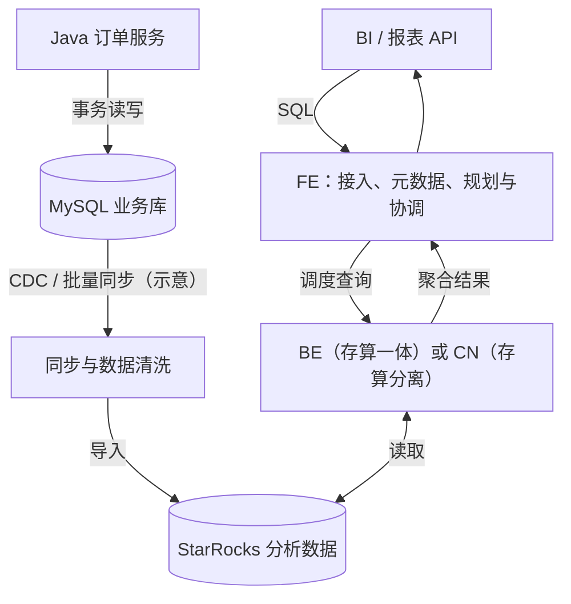

# StarRocks 是什么？为什么需要 OLAP 数据库？

> StarRocks What 系列 01/15 · 中文技术审阅稿 · 2026-11-10  
> 目标读者：有十年 Java/MySQL 经验的工程师。  
> 核心问题：为什么“查询订单”与“分析订单”会催生不同的数据库设计？

## 一、问题引入：从物流订单日报开始

一个物流订单系统用 MySQL 保存订单。订单服务关心创建订单、修改状态、按主键查询，运营报表则要统计“昨天每个网点有多少有效订单”，并按日期、网点、地区和状态灵活钻取。

```sql
SELECT order_day, site_id, COUNT(*) AS order_count
FROM orders
WHERE order_day >= '2026-11-06'
  AND order_day < '2026-11-07'
GROUP BY order_day, site_id
ORDER BY order_count DESC;
```

这条 SQL 在 MySQL 中完全合法。**问题不在于 MySQL 不能聚合，而在于数据量、扫描范围、查询并发、维度组合和事务写入压力增长后，分析负载与事务负载的优化目标可能冲突。**

订单服务希望迅速定位一行并原子更新；报表希望扫描大量行、只读取少数列、执行聚合并合并结果。更重要的是：必须先定义“有效订单”——创建事件数、当前有效订单数还是去重订单数？若订单被撤销、消息被重复投递，`COUNT(*)` 可能统计错误。数据库再快也不能替代业务口径。

## 二、概念定位：OLTP 与 OLAP 是负载差异

| 维度 | 典型 OLTP | 典型 OLAP |
| --- | --- | --- |
| 访问方式 | 主键点查、短事务、少量行更新 | 大范围扫描、多维过滤、JOIN、GROUP BY |
| 优化目标 | 单事务延迟、写入并发、事务正确性 | 扫描吞吐、并行计算、聚合延迟 |
| 常见组织 | 行式布局、事务索引 | 列式布局、压缩、数据跳过 |
| 主要风险 | 锁竞争、热点、日志与随机 I/O | 扫描字节、内存、CPU、网络交换与倾斜 |
| 正确性关注 | 提交、约束、事务隔离 | 数据新鲜度、口径、去重、快照可见性 |

这些是典型倾向而非绝对规则：MySQL 可以承担适量分析，OLAP 数据库也可以支持更新。架构选型必须以实际负载为依据。

## 三、StarRocks 是什么？

**[F·官方事实]** StarRocks 是面向实时分析的 MPP 分析数据库，提供列式存储、向量化执行、基于成本的优化器（CBO）、物化视图、数据导入能力和 MySQL 协议兼容的查询接口。参见 [StarRocks Introduction](https://docs.starrocks.io/docs/introduction/StarRocks_intro)。

其设计思想是一条相互配合的成本优化链：

1. **列式存储**：只访问少数列时，减少无关列的读取；同类数据也更容易压缩。但过滤与数据分布仍决定实际扫描量。
2. **MPP（大规模并行处理）**：把查询分配给多个节点执行，利用并行扫描和局部聚合；代价是跨节点传输和协调开销。
3. **向量化执行**：一次处理一批数据，减少逐行解释和函数调用开销，更有效地使用 CPU。
4. **CBO**：根据统计信息和代价估计选择物理执行计划；统计失真时可能误判。
5. **实时导入与可更新表模型**：支持较新的分析数据，但必须单独衡量导入、发布与查询可见性延迟。
6. **物化视图**：通过预计算降低重复分析成本，换来额外存储、刷新和新鲜度管理。

**[H·条件性推断]** 这些机制的共同目标是降低“读取字节数、计算工作量、网络交换量、等待数据可见的时间”；并不保证每条 SQL 都快，也不解决源数据本身的业务错误。

## 四、核心架构：事务主库与分析副本分工



**[F·官方事实]** FE 承担查询规划、元数据管理等职责；shared-nothing（存算一体）架构的 BE 负责存储与计算；shared-data（存算分离）架构由 CN 承担计算，持久数据存放于共享存储。具体能力和最低版本需要按部署模式核对。[官方架构文档](https://docs.starrocks.io/docs/introduction/Architecture)。

**[H·设计推断]** 把分析负载移出 MySQL 有助于隔离资源竞争，却增加同步延迟、两套系统运维、数据质量对账和故障恢复的复杂性。图中同步方式仅为概念示意，不代表 StarRocks 自动复制任意 MySQL 表。

## 五、从订单 SQL 理解数据路径


列存使查询有机会少读列；MPP 让扫描与聚合并行；向量化降低单节点计算开销。但如果数据按订单号分布、查询按网点聚合，局部聚合结果可能需要跨节点交换；热点网点还可能造成倾斜。**不是每条 SQL 都必然有 Exchange**，以实际 EXPLAIN 为准。第 03 篇详细讨论完整查询路径，第 07 篇讨论 Fragment、Pipeline 和 Exchange。

## 六、两个可行选择及决策边界

### 方案 A：保留 MySQL，优化索引与读副本

收益：组件少，业务语义和事务链路清晰；当数据量适中、查询固定、索引覆盖有效、分析并发低时，可能已经足够。读副本可隔离部分读流量。

代价：复杂多维分析难以由少数索引覆盖；历史数据持续增长后，扫描和聚合可能争抢 CPU、I/O 与缓存；读副本仍有复制延迟。

### 方案 B：MySQL 承担 OLTP，StarRocks 承担 OLAP

收益：分析负载隔离；利用列存、并行计算和优化器处理大规模多维聚合，可独立规划分析容量。

代价：引入同步链路、双系统存储、数据新鲜度 SLA、对账、运维与故障恢复成本。

| 决策条件 | 更倾向 A | 更值得评估 B |
| --- | --- | --- |
| 查询 | 少量固定、索引高选择性 | 多维探索、频繁大范围聚合 |
| 负载 | 分析并发低 | 分析影响事务 SLA |
| 数据规模 | 小或中等、增长可控 | 历史数据持续增长 |
| 团队成本 | 无力承担新系统 | 能维护同步、监控与容量 |
| 新鲜度 | 现有模式满足需求 | 可明确约束同步到可见延迟 |

**决策边界**：不能仅凭“StarRocks 是 OLAP”或某个单次延迟结果选型。必须先定义正确性、新鲜度、性能和成本目标，再以可复现实验判断。

## 七、可复现验证：先正确，再谈快

### 7.1 固定数据契约

测试字段：`order_id`、`order_day`、`site_id`、`status`。假设一行代表一笔去重后的当前有效订单；取消状态是否计入必须统一定义。

构造样本：2026-11-06 网点 10 有 5 笔有效订单、网点 20 有 1 笔；次日另有 1 笔。单日预期结果是 `(2026-11-06,10,5)` 和 `(2026-11-06,20,1)`。**这是人为构造的正确性断言，不是实测结果。**

### 7.2 比较相同语义的 SQL

```sql
SELECT order_day, site_id, COUNT(*) AS order_count
FROM orders
WHERE order_day >= '2026-11-06'
  AND order_day < '2026-11-07'
GROUP BY order_day, site_id;
```

将两端数据固定到同一快照，核对行数、重复订单、取消状态、跨日边界和完整结果集；结果不一致时禁止直接比较性能。

### 7.3 逐步放大并记录证据

建议设计十万、百万、千万行三个数据规模（**仅为计划值，不是实测**），对比高选择性点查和低选择性聚合，并控制硬件、缓存、并发和版本差异。

| 指标 | 观察目的 | 反证 |
| --- | --- | --- |
| p50 / p95 | 查询时延与长尾 | 均值改善但长尾恶化 |
| 扫描行数 / 字节 | 数据跳过与列存收益 | 仍大量全表扫描 |
| CPU / 内存 / 网络 | 瓶颈迁移 | Exchange 或内存成瓶颈 |
| 数据可见延迟 | 是否足够实时 | 查询快但数据落后 |
| 结果差异数 | 业务正确性 | 漏单、重复或旧状态 |
| 故障成功率 / 恢复时间 | 可用性 | 节点故障超过 SLA |

MySQL 可在适用版本使用 `EXPLAIN ANALYZE`；StarRocks 使用 `EXPLAIN` 和 Query Profile 观察计划与实际开销。不同引擎的计时口径不可机械比较。[StarRocks EXPLAIN](https://docs.starrocks.io/docs/sql-reference/sql-statements/cluster-management/plan_profile/EXPLAIN/)；[Query Profile](https://docs.starrocks.io/docs/best_practices/query_tuning/query_profile_overview/)。

### 7.4 故障路径

- **同步暂停**：MySQL 已更新，分析库仍是旧数据。应监控源端水位、目标可见水位及差距，恢复后验证是否漏算或重复。
- **计算节点故障**：可能出现查询失败、超时或恢复等待；不能因为有副本就断言零故障，需按实际部署模式演练。
- **业务口径变化**：例如取消订单不再计入；即使查询毫秒级完成，也可能返回错误统计。必须让口径定义成为自动化断言。

## 八、作者练习

1. 画出 Java 订单服务、MySQL、同步链路、StarRocks、报表 API 的关系，并标出事务正确性与分析新鲜度的边界。
2. 用自己的话解释：为什么“列存少读列”不等于“MPP 没有网络开销”？
3. 假设只有 50 万行订单、每天 20 次报表查询，且 MySQL 已有有效覆盖索引：写出暂不引入 StarRocks 的理由，以及三个触发重新评估的信号。

**关键审稿问题**：假设 StarRocks 的日报查询只需 100ms、MySQL 需 2s，但 StarRocks 数据落后 5 分钟。你会如何定义正确性、新鲜度和查询延迟 SLA，决定哪个方案真正符合业务？

## 九、证据说明与后续篇章

- **F**：官方事实，依据下列英文文档。本文以官方文档 Latest 4.1 为查阅基线，具体行为须在目标版本验证。
- **H**：条件性推断和实验假设，不能写成既成事实。
- **O**：真实观测。**本篇暂无真实实验记录**，没有生产事故故事或性能结论。

参考资料：

1. [StarRocks Introduction](https://docs.starrocks.io/docs/introduction/StarRocks_intro)
2. [StarRocks Architecture](https://docs.starrocks.io/docs/introduction/Architecture)
3. [StarRocks EXPLAIN](https://docs.starrocks.io/docs/sql-reference/sql-statements/cluster-management/plan_profile/EXPLAIN/)
4. [StarRocks Query Profile Overview](https://docs.starrocks.io/docs/best_practices/query_tuning/query_profile_overview/)

下一篇：**StarRocks 整体架构：FE、BE、CN 的职责**。本篇只回答“为什么需要这种数据库”，不提前深入 SQL 算子、导入语义和表模型实现；它们分别在第 03、10、11 篇展开。
